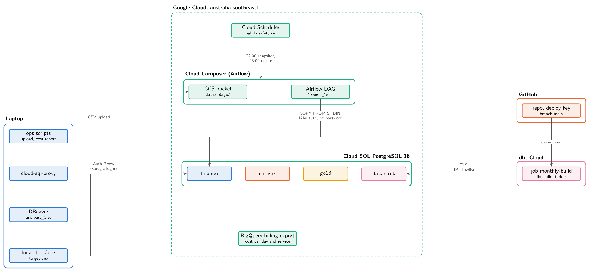
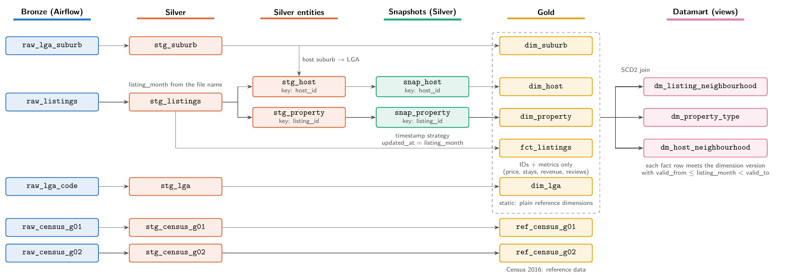

# Sydney Airbnb and Census ELT pipeline

UTS Big Data Engineering, Assignment 3. An ELT pipeline for Sydney Airbnb listings (May 2020 to April 2021, one CSV per month) and 2016 Census data (G01 and G02 at LGA level, plus an LGA and suburb mapping). Airflow on Cloud Composer loads the raw files into PostgreSQL 16 on Cloud SQL (Bronze). dbt Cloud then builds Silver (cleaned models and SCD2 snapshots), Gold (star schema plus Census reference tables) and a datamart of three views. All 12 months were loaded one at a time in chronological order, with the dbt job run after each load.

## Architecture





## Repository layout

```
src/                     Everything that goes into the submission zip
  part_1.sql             Bronze schema, raw tables, grants (run in DBeaver)
  part_4.sql             Ad-hoc analysis queries
  dags/bronze_load.py    The single Airflow DAG for Parts 1 and 3
  dbt/                   dbt project trn_uts_dateng (models, snapshots, tests, macros)
ops/                     Operations scripts and append-only logs
  composer.sh            Composer lifecycle: up, status, evidence, hold, down
  monthly_cycle.sh       One Part 3 cycle: upload, DAG, Bronze check, dbt job
  cost_report.sh         GCP cost per day and service from the billing export
  logs/                  Run logs and exported Airflow evidence
doc/                     Cleaned brief and diagram sources (doc/figures/)
screenshots/             Figure evidence (images are gitignored, MANIFEST.md lists them)
EXPLAINABILITY.md        Technical logbook for engineers (entries E1 to E22)
STORYTELLING.md          Narrative plan for the report (audience, arc, number bank)
```

## The pipeline in five steps

0. **Download.** 12 monthly listing files, Census G01 and G02, and the LGA mapping.
1. **Load the first month.** `part_1.sql` creates the Bronze schema and raw tables in DBeaver. The DAG `bronze_load` (`schedule_interval=None`) loaded May 2020 (37562 listings), the Census tables (132 rows each), 129 LGAs and 4470 suburbs, matching the file counts exactly.
2. **Design the warehouse.** dbt builds Silver, Gold and the datamart (`dm_listing_neighbourhood`, `dm_property_type`, `dm_host_neighbourhood`). Two snapshots (host, property) use the timestamp strategy. A first official run built 75 nodes with all tests passing.
3. **Load the remaining months.** Each month: upload, run the DAG, check that Bronze holds the file's row count, run the dbt job. About 2.5 minutes per cycle.
4. **Ad-hoc analysis.** Five business questions answered in `src/part_4.sql`; answers and screenshots are in the report.

## How to run

Prerequisites: `gcloud`, `cloud-sql-proxy`, DBeaver, `uv`, and a dbt Core 1.12.5 plus dbt-postgres 1.11.0 virtual environment (versions pinned in `src/dbt/requirements.txt`). Do not use dbt v2 (Fusion): it has no Postgres adapter. Credentials live in a gitignored `.env`.

```bash
# 1. Proxy to Cloud SQL (own terminal, keep it running)
cloud-sql-proxy --port 5433 "$(gcloud sql instances describe bde-at3-pg --format='value(connectionName)')"

# 2. Part 1 schema: open src/part_1.sql in DBeaver and run it

# 3. Local dbt (target dev writes schema dbt_dev, never the deployment schemas)
cd src/dbt && set -a; . ../../.env; set +a
~/.venvs/trn-uts-dateng/bin/dbt debug
~/.venvs/trn-uts-dateng/bin/dbt build -s <model_name>

# 4. Composer and the monthly cycle
ops/composer.sh up|status|evidence|hold|down
ops/monthly_cycle.sh 05_2020.csv [--dbt-only]

# 5. Cost snapshot at the end of a session
ops/cost_report.sh
```

Run `ops/composer.sh evidence` before `down`: deleting Composer erases Airflow's run history.

## Results at a glance

- Bronze holds 412122 listing rows and `gold.fct_listings` holds 412122, so nothing was lost or duplicated.
- 31001 hosts with 34610 versions; 45613 listings with 82944 property versions.
- Datamart rows: 348 (`dm_listing_neighbourhood`), 4988 (`dm_property_type`), 349 (`dm_host_neighbourhood`).
- Airflow: 12 runs, 12 successes (mean run time 16 s). dbt Cloud: 12 runs, each `PASS=75 WARN=0 ERROR=0`.
- Every fact row matched exactly one host version and one property version in all 12 months.
- Part 4 answers: see the report.

## Design decisions

- **Listing month from the file name.** 4780 rows of the July 2020 file carry a scrape date in September, so the month is taken from the file, not the row.
- **SCD2 on the right timestamp.** A version starts at the first month of an attribute run. The datamart joins each fact to the dimension version valid at its month, never the latest.
- **IAM database authentication.** The DAG signs in as a service account through the Cloud SQL Python Connector; no password is stored anywhere.
- **Idempotent loads.** Re-running a month replaces that month's rows, and `pick_month` refuses to skip a month, with `max_active_runs=1`.
- **NULLIF on empty strings.** Blanks in the CSVs become NULL, so casts and rates are not distorted.
- **Calendar-month lag.** Month-to-month percentage change compares with the previous calendar month, so a gap yields NULL instead of a wrong comparison.

## Security and cost

No secrets are committed: `.env` and `dbt_cloud.yml` are gitignored, and tracked files use placeholders instead of project IDs, hosts or addresses. The warehouse accepts only the authenticated proxy and dbt Cloud over encrypted connections. Composer is the expensive resource, so it is created for work, exported with `evidence`, then deleted with `down`; a nightly Cloud Scheduler job is the safety net. Real spend per day and service comes from the BigQuery billing export (`ops/cost_report.sh`).

## Further reading

- [EXPLAINABILITY.md](EXPLAINABILITY.md): every execution with commands, results, issues and fixes.
- [STORYTELLING.md](STORYTELLING.md): the narrative, verified numbers and evidence strength behind the report.
